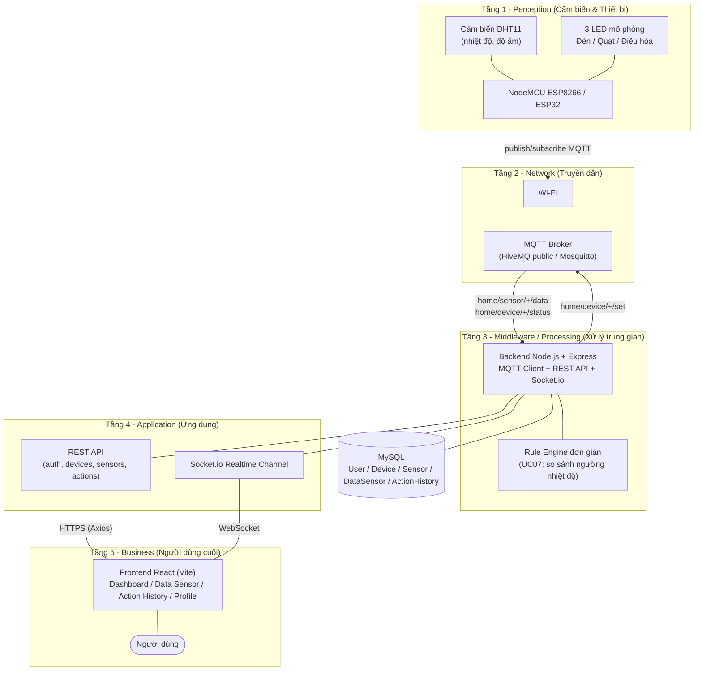

# Kiến trúc tổng quan hệ thống (System Architecture)

Hệ thống được tổ chức theo mô hình kiến trúc IoT 5 tầng phổ biến (Perception - Network - Middleware/Processing - Application - Business), áp dụng cụ thể vào đồ án như sau:

## Giải thích từng tầng

- **Tầng 1 — Perception**: phần cứng thật, nơi dữ liệu vật lý được sinh ra (DHT11 đọc nhiệt độ/độ ẩm) và nơi hành động vật lý xảy ra (LED bật/tắt thay cho đèn/quạt/điều hòa thật).
- **Tầng 2 — Network**: NodeMCU kết nối Wi-Fi, giao tiếp với các thành phần còn lại của hệ thống hoàn toàn qua giao thức MQTT (publish/subscribe) thông qua một MQTT Broker công cộng, không cần biết địa chỉ IP của nhau.
- **Tầng 3 — Middleware/Processing**: Backend đóng vai trò trung tâm — vừa là MQTT client (subscribe dữ liệu cảm biến & trạng thái, publish lệnh điều khiển), vừa chứa "rule engine" đơn giản cho UC07 (so sánh giá trị cảm biến với ngưỡng cấu hình để tự quyết định có cần hành động hay không).
- **Tầng 4 — Application**: Backend expose ra ngoài dưới 2 hình thức — REST API (thao tác yêu cầu/phản hồi: đăng nhập, lấy danh sách, điều khiển) và kênh Socket.io (đẩy dữ liệu thời gian thực một chiều xuống Frontend khi có sự kiện mới).
- **Tầng 5 — Business**: Frontend React là giao diện người dùng cuối, tiêu thụ cả 2 kênh trên để hiển thị dữ liệu tức thời và cho phép người dùng ra quyết định (bật/tắt thiết bị).
- **MySQL** đóng vai trò lưu trữ bền vững xuyên suốt, được Backend đọc/ghi ở tầng Middleware, không expose trực tiếp ra Frontend (đảm bảo tách lớp, bảo mật).
