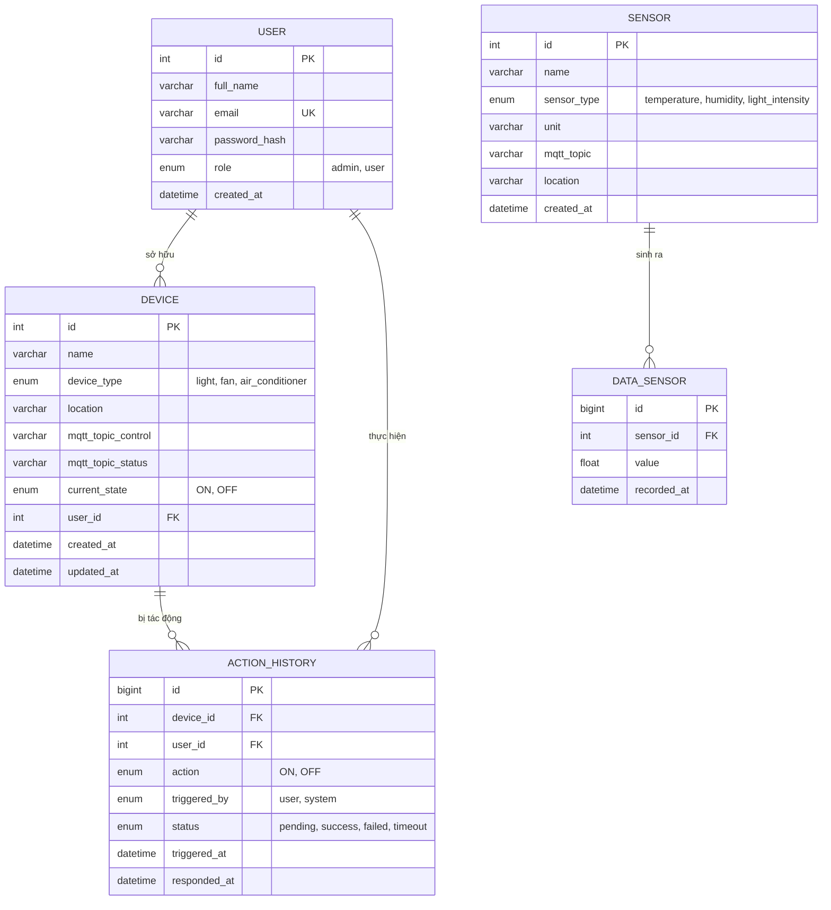

# Bài 1 — Thiết kế Cơ sở dữ liệu (Database Design)

## 1. Sơ đồ ERD



## 2. Giải thích thiết kế

- **User**: tài khoản đăng nhập hệ thống, sở hữu các `Device`, là người thực hiện hành động trong `ActionHistory`.
- **Device**: đại diện cho 3 "thiết bị điện" thật (đèn, quạt, điều hòa) — mỗi thiết bị ứng với 1 LED trên board. Lưu topic MQTT riêng để backend biết publish lệnh xuống đâu và subscribe trạng thái ở đâu.
- **Sensor**: đại diện cảm biến vật lý gắn trên board (VD: DHT11 đo nhiệt độ + độ ẩm) — tách riêng khỏi `Device` vì một board có thể có nhiều cảm biến nhưng không phải là thứ người dùng "bật/tắt".
- **DataSensor**: bảng time-series lưu từng giá trị đọc được từ `Sensor` theo thời gian → dùng vẽ biểu đồ ở trang Data Sensor & Dashboard. Nên đánh index theo `(sensor_id, recorded_at)` vì đây là bảng lớn nhất, tăng nhanh nhất theo thời gian.
- **ActionHistory**: log mọi lệnh bật/tắt — ai bấm, bấm gì, lúc nào, kết quả có thành công tới phần cứng hay không (dùng cho UC03, UC05, UC07 và cho sequence diagram bên dưới). Cột `triggered_by` phân biệt lệnh do người dùng bấm tay (`user`) hay do hệ thống tự động sinh ra khi cảm biến vượt ngưỡng (`system`) — phục vụ UC07 (cảnh báo & tự xử lý).

### 2.1. Chi tiết từng bảng

**Bảng `User`**

| Tên cột | Kiểu dữ liệu | Ràng buộc | Mô tả chi tiết |
|---|---|---|---|
| id | INT | PRIMARY KEY, AUTO_INCREMENT | Định danh duy nhất cho mỗi tài khoản |
| full_name | VARCHAR(100) | NOT NULL | Họ tên hiển thị của người dùng, dùng ở trang Profile và Sidebar |
| email | VARCHAR(150) | NOT NULL, UNIQUE | Dùng làm tên đăng nhập (login identifier), không trùng lặp |
| password_hash | VARCHAR(255) | NOT NULL | Mật khẩu đã băm bằng bcryptjs (không lưu plaintext) |
| role | ENUM('admin','user') | NOT NULL, DEFAULT 'user' | Phân quyền: `admin` có thể quản lý thiết bị, `user` chỉ xem/điều khiển |
| created_at | DATETIME | NOT NULL, DEFAULT CURRENT_TIMESTAMP | Thời điểm tạo tài khoản |

**Bảng `Device`**

| Tên cột | Kiểu dữ liệu | Ràng buộc | Mô tả chi tiết |
|---|---|---|---|
| id | INT | PRIMARY KEY, AUTO_INCREMENT | Định danh thiết bị, cũng dùng để tạo topic MQTT (VD: id=1 → `home/device/1/set`) |
| name | VARCHAR(100) | NOT NULL | Tên hiển thị (VD: "Đèn phòng khách") |
| device_type | ENUM('light','fan','air_conditioner') | NOT NULL | Loại thiết bị — ứng với 1 trong 3 LED mô phỏng trên board |
| location | VARCHAR(100) | NULL | Vị trí lắp đặt (VD: "Phòng khách") |
| mqtt_topic_control | VARCHAR(150) | NOT NULL | Topic Backend publish lệnh điều khiển xuống Hardware |
| mqtt_topic_status | VARCHAR(150) | NOT NULL | Topic Hardware publish trạng thái thật lên Backend |
| current_state | ENUM('ON','OFF') | NOT NULL, DEFAULT 'OFF' | Trạng thái hiện tại, đồng bộ theo trạng thái thật từ Hardware (không phải trạng thái mong muốn) |
| user_id | INT | NOT NULL, FOREIGN KEY → User(id) | Chủ sở hữu / người quản lý thiết bị |
| created_at | DATETIME | NOT NULL, DEFAULT CURRENT_TIMESTAMP | Thời điểm khởi tạo bản ghi thiết bị |
| updated_at | DATETIME | NOT NULL, ON UPDATE CURRENT_TIMESTAMP | Thời điểm trạng thái được cập nhật gần nhất |

**Bảng `Sensor`**

| Tên cột | Kiểu dữ liệu | Ràng buộc | Mô tả chi tiết |
|---|---|---|---|
| id | INT | PRIMARY KEY, AUTO_INCREMENT | Định danh cảm biến, dùng tạo topic MQTT (VD: id=1 → `home/sensor/1/data`) |
| name | VARCHAR(100) | NOT NULL | Tên hiển thị (VD: "Cảm biến nhiệt độ") |
| sensor_type | ENUM('temperature','humidity','light_intensity') | NOT NULL | Loại đại lượng đo được |
| unit | VARCHAR(20) | NOT NULL | Đơn vị đo (°C, %, lux) |
| mqtt_topic | VARCHAR(150) | NOT NULL | Topic Hardware publish giá trị đo lên Backend |
| location | VARCHAR(100) | NULL | Vị trí lắp đặt cảm biến |
| created_at | DATETIME | NOT NULL, DEFAULT CURRENT_TIMESTAMP | Thời điểm khởi tạo bản ghi cảm biến |

**Bảng `DataSensor`**

| Tên cột | Kiểu dữ liệu | Ràng buộc | Mô tả chi tiết |
|---|---|---|---|
| id | BIGINT | PRIMARY KEY, AUTO_INCREMENT | Định danh bản ghi đo (dùng BIGINT vì bảng tăng rất nhanh theo thời gian) |
| sensor_id | INT | NOT NULL, FOREIGN KEY → Sensor(id) | Bản ghi này thuộc cảm biến nào |
| value | FLOAT | NOT NULL | Giá trị đo được tại thời điểm `recorded_at` |
| recorded_at | DATETIME | NOT NULL, DEFAULT CURRENT_TIMESTAMP | Thời điểm ghi nhận giá trị, có index kết hợp `(sensor_id, recorded_at)` để truy vấn biểu đồ nhanh |

**Bảng `ActionHistory`**

| Tên cột | Kiểu dữ liệu | Ràng buộc | Mô tả chi tiết |
|---|---|---|---|
| id | BIGINT | PRIMARY KEY, AUTO_INCREMENT | Định danh bản ghi hành động |
| device_id | INT | NOT NULL, FOREIGN KEY → Device(id) | Thiết bị bị tác động |
| user_id | INT | NOT NULL, FOREIGN KEY → User(id) | Người thực hiện hành động (với `triggered_by='system'`, đây là user sở hữu thiết bị, dùng để hiển thị "hệ thống tự động xử lý cho tài khoản nào") |
| action | ENUM('ON','OFF') | NOT NULL | Lệnh được gửi đi |
| triggered_by | ENUM('user','system') | NOT NULL, DEFAULT 'user' | Nguồn phát sinh lệnh: `user` = người dùng bấm nút trên giao diện (UC03); `system` = Backend tự động phát hiện cảm biến vượt ngưỡng và tự sinh lệnh (UC07) |
| status | ENUM('pending','success','failed','timeout') | NOT NULL, DEFAULT 'pending' | Trạng thái xử lý: `pending` khi vừa publish, `success` khi Hardware phản hồi đúng, `timeout` khi quá `ACTION_TIMEOUT_MS` không phản hồi |
| triggered_at | DATETIME | NOT NULL, DEFAULT CURRENT_TIMESTAMP | Thời điểm lệnh được publish xuống MQTT |
| responded_at | DATETIME | NULL | Thời điểm Hardware phản hồi trạng thái thật (null nếu đang `pending`) |

## 3. SQL Schema (MySQL 8)

```sql
CREATE DATABASE IF NOT EXISTS iot_device_manager
  CHARACTER SET utf8mb4 COLLATE utf8mb4_unicode_ci;
USE iot_device_manager;

CREATE TABLE `User` (
    id              INT AUTO_INCREMENT PRIMARY KEY,
    full_name       VARCHAR(100) NOT NULL,
    email           VARCHAR(150) NOT NULL UNIQUE,
    password_hash   VARCHAR(255) NOT NULL,
    role            ENUM('admin', 'user') NOT NULL DEFAULT 'user',
    created_at      DATETIME NOT NULL DEFAULT CURRENT_TIMESTAMP
) ENGINE=InnoDB;

CREATE TABLE `Device` (
    id                  INT AUTO_INCREMENT PRIMARY KEY,
    name                VARCHAR(100) NOT NULL,
    device_type         ENUM('light', 'fan', 'air_conditioner') NOT NULL,
    location            VARCHAR(100) DEFAULT NULL,
    mqtt_topic_control  VARCHAR(150) NOT NULL,   -- home/device/{id}/set
    mqtt_topic_status   VARCHAR(150) NOT NULL,   -- home/device/{id}/status
    current_state       ENUM('ON', 'OFF') NOT NULL DEFAULT 'OFF',
    user_id             INT NOT NULL,
    created_at          DATETIME NOT NULL DEFAULT CURRENT_TIMESTAMP,
    updated_at          DATETIME NOT NULL DEFAULT CURRENT_TIMESTAMP ON UPDATE CURRENT_TIMESTAMP,
    CONSTRAINT fk_device_user FOREIGN KEY (user_id) REFERENCES `User`(id) ON DELETE CASCADE
) ENGINE=InnoDB;

CREATE TABLE `Sensor` (
    id              INT AUTO_INCREMENT PRIMARY KEY,
    name            VARCHAR(100) NOT NULL,
    sensor_type     ENUM('temperature', 'humidity', 'light_intensity') NOT NULL,
    unit            VARCHAR(20) NOT NULL,        -- '°C', '%', 'lux'
    mqtt_topic      VARCHAR(150) NOT NULL,       -- home/sensor/{id}/data
    location        VARCHAR(100) DEFAULT NULL,
    created_at      DATETIME NOT NULL DEFAULT CURRENT_TIMESTAMP
) ENGINE=InnoDB;

CREATE TABLE `DataSensor` (
    id              BIGINT AUTO_INCREMENT PRIMARY KEY,
    sensor_id       INT NOT NULL,
    value           FLOAT NOT NULL,
    recorded_at     DATETIME NOT NULL DEFAULT CURRENT_TIMESTAMP,
    CONSTRAINT fk_datasensor_sensor FOREIGN KEY (sensor_id) REFERENCES `Sensor`(id) ON DELETE CASCADE,
    INDEX idx_sensor_time (sensor_id, recorded_at)
) ENGINE=InnoDB;

CREATE TABLE `ActionHistory` (
    id              BIGINT AUTO_INCREMENT PRIMARY KEY,
    device_id       INT NOT NULL,
    user_id         INT NOT NULL,
    action          ENUM('ON', 'OFF') NOT NULL,
    triggered_by    ENUM('user', 'system') NOT NULL DEFAULT 'user',
    status          ENUM('pending', 'success', 'failed', 'timeout') NOT NULL DEFAULT 'pending',
    triggered_at    DATETIME NOT NULL DEFAULT CURRENT_TIMESTAMP,
    responded_at    DATETIME DEFAULT NULL,
    CONSTRAINT fk_action_device FOREIGN KEY (device_id) REFERENCES `Device`(id) ON DELETE CASCADE,
    CONSTRAINT fk_action_user FOREIGN KEY (user_id) REFERENCES `User`(id) ON DELETE CASCADE,
    INDEX idx_device_time (device_id, triggered_at)
) ENGINE=InnoDB;
```

## 4. Dữ liệu mẫu (seed) cho 3 "đèn LED" đóng vai Đèn / Quạt / Điều hòa

```sql
INSERT INTO `User` (full_name, email, password_hash, role)
VALUES ('Đỗ Minh Quân', 'quan@example.com', '$2b$10$examplehash', 'admin');

INSERT INTO `Device` (name, device_type, location, mqtt_topic_control, mqtt_topic_status, user_id)
VALUES
('Đèn phòng khách',  'light',           'Phòng khách', 'home/device/1/set', 'home/device/1/status', 1),
('Quạt phòng khách', 'fan',             'Phòng khách', 'home/device/2/set', 'home/device/2/status', 1),
('Điều hòa phòng ngủ','air_conditioner','Phòng ngủ',   'home/device/3/set', 'home/device/3/status', 1);

INSERT INTO `Sensor` (name, sensor_type, unit, mqtt_topic, location)
VALUES
('Cảm biến nhiệt độ', 'temperature', '°C', 'home/sensor/1/data', 'Phòng khách'),
('Cảm biến độ ẩm',    'humidity',    '%',  'home/sensor/2/data', 'Phòng khách'),
('Cảm biến ánh sáng', 'light_intensity', 'lux', 'home/sensor/3/data', 'Phòng khách');
```

File SQL đầy đủ (schema + seed) cũng được lưu tại `backend/db/schema.sql` để chạy trực tiếp khi dựng Backend.
