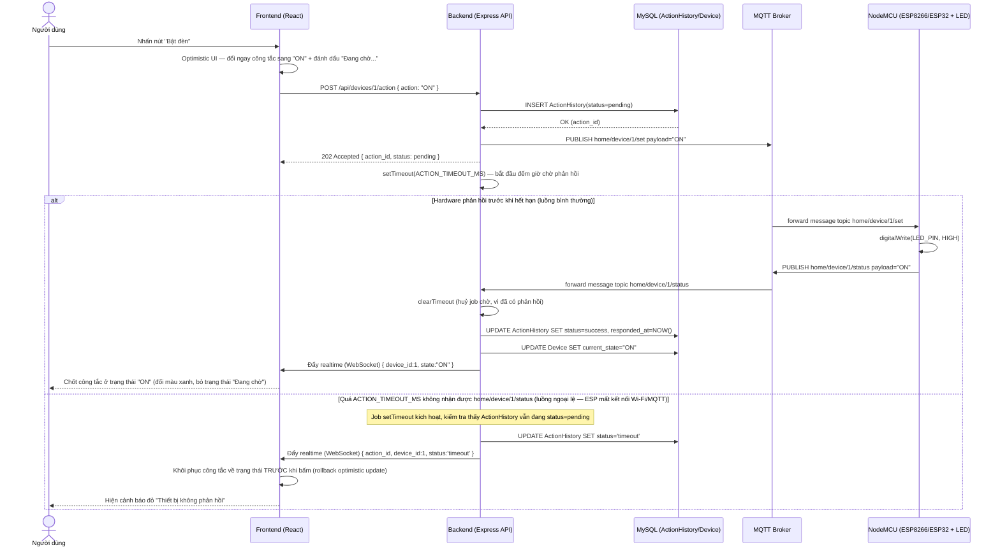
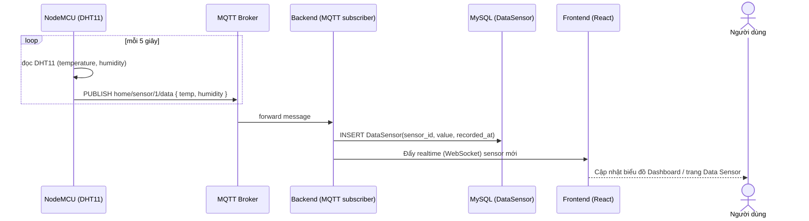
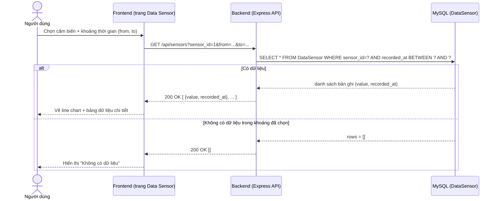
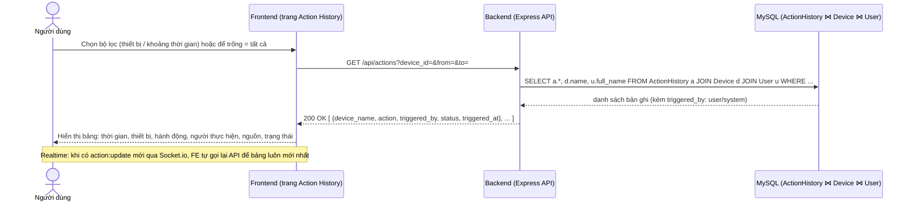
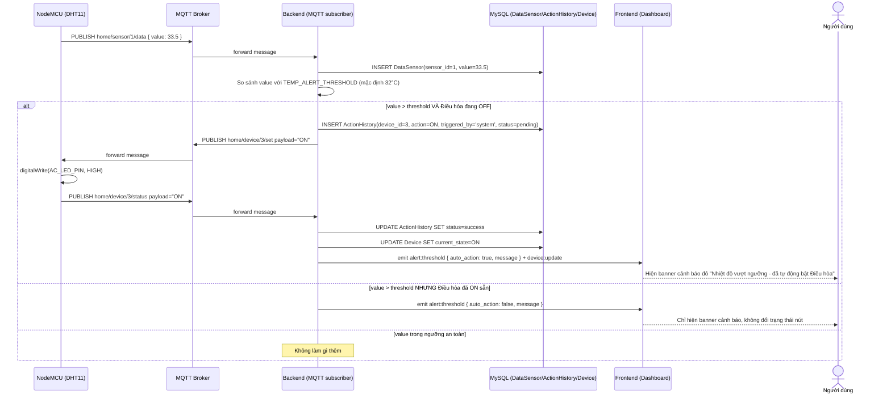
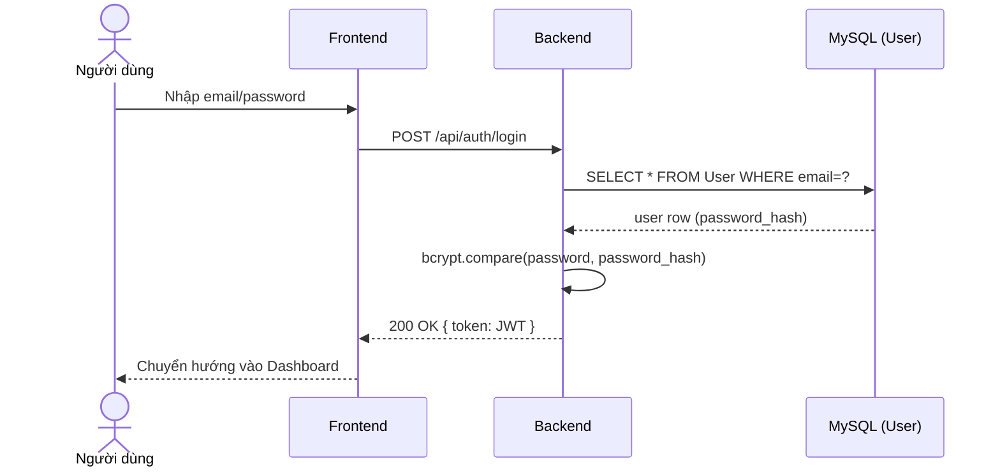

# Bài 1 — Sequence Diagram (Biểu đồ tuần tự)

## 1. Luồng chính: Bật/Tắt thiết bị (UC03)

Người dùng bấm nút "Bật đèn" trên Dashboard → lệnh đi từ Frontend xuống Backend, lưu DB, truyền qua MQTT xuống Hardware (NodeMCU), và phản hồi ngược lại để UI cập nhật đúng trạng thái thật.

Nhánh `else` được thiết kế mô phỏng đúng theo hành vi rollback UI chuẩn (giống cách nhiều hệ thống điều khiển thiết bị thực tế xử lý): Frontend không đợi xác nhận mới đổi màu công tắc, mà đổi ngay khi người dùng bấm (optimistic UI) để cảm giác phản hồi tức thời; nếu sau đó phát hiện lệnh bị timeout, Frontend sẽ **tự động trả công tắc về đúng trạng thái trước khi bấm** và hiển thị cảnh báo đỏ, thay vì để công tắc "treo" ở trạng thái sai. Cơ chế này được hiện thực trong `frontend/src/pages/Dashboard.jsx` (hàm `toggleDevice` lưu trạng thái cũ vào `rollbackRef` trước khi optimistic-update, và khôi phục lại khi nhận sự kiện `action:update` với `status: 'timeout'`).

Nhánh `else` ở trên chính là luồng ngoại lệ: nếu sau `ACTION_TIMEOUT_MS` (mặc định 5 giây) Backend không nhận được message trên `home/device/1/status`, job hẹn giờ đã đặt ở bước `setTimeout` sẽ tự kiểm tra và `UPDATE ActionHistory SET status='timeout'`, đồng thời đẩy realtime báo lỗi xuống Frontend. Cơ chế này được hiện thực đúng như vậy trong `backend/src/routes/devices.routes.js`.

## 2. Luồng phụ: Thu thập dữ liệu cảm biến thời gian thực (phục vụ UC02 Dashboard, là nguồn dữ liệu cho UC04)

## 3. Luồng tra cứu dữ liệu cảm biến theo thời gian (UC04 — trang Data Sensor)

Khác với luồng thu thập realtime ở mục 2 (đẩy dữ liệu mới xuống ngay khi có), luồng này là người dùng **chủ động truy vấn lại** dữ liệu đã lưu theo bộ lọc (cảm biến, khoảng thời gian) để xem biểu đồ/bảng lịch sử.

## 4. Luồng tra cứu lịch sử hành động (UC05 — trang Action History)

## 5. Luồng cảnh báo & tự động xử lý khi vượt ngưỡng (UC07 — bonus)

Khác với UC03 (người dùng chủ động bấm nút), luồng này do chính **Backend** phát hiện và tự sinh ra lệnh điều khiển — thể hiện `ActionHistory.triggered_by = 'system'`.

**Trường hợp lỗi**: nếu Hardware không phản hồi `home/device/3/status` trong `ACTION_TIMEOUT_MS`, lệnh tự động này cũng bị đánh dấu `status='timeout'` giống hệt cơ chế của UC03.

## 6. Luồng đăng nhập (UC01) — tham chiếu ngắn gọn

