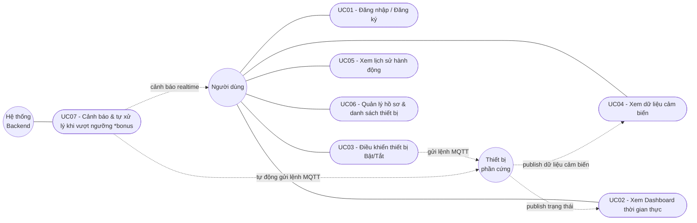

# Bài 1 — Đặc tả Use Case
## Hệ thống Quản lý Thiết bị điện thông minh (IoT Smart Home Controller)

### 1. Danh sách tác nhân (Actor)

| Tác nhân | Mô tả |
|---|---|
| **Người dùng (User)** | Chủ nhà / người dùng cuối, đăng nhập vào Web App để giám sát và điều khiển thiết bị. |
| **Thiết bị phần cứng (Device/Hardware)** | NodeMCU ESP8266/ESP32 gắn cảm biến + 3 LED (đèn, quạt, điều hòa), giao tiếp qua MQTT. |
| **MQTT Broker** | Tác nhân trung gian (Mosquitto/CloudMQTT), không phải người dùng nhưng đóng vai trò hệ thống ngoài. |

### 2. Sơ đồ Use Case (tổng quan)

> Ghi chú: đây là bản mermaid dùng để xem trước nhanh. Khi nộp báo cáo, vẽ lại bằng ký hiệu UML Use Case chuẩn (oval/actor) trong draw.io hoặc StarUML cho đúng quy cách, nội dung giữ nguyên như mô tả bên dưới.

---

### UC01 — Đăng nhập / Đăng ký tài khoản

| Thuộc tính | Nội dung |
|---|---|
| **Mã Use Case** | UC01 |
| **Tác nhân chính** | Người dùng |
| **Mô tả** | Người dùng đăng ký tài khoản mới hoặc đăng nhập để truy cập hệ thống. |
| **Điều kiện tiên quyết** | Người dùng có kết nối Internet, truy cập được trang Web. |
| **Luồng sự kiện chính** | 1. Người dùng mở trang Login. 2. Nhập email/username và mật khẩu. 3. Hệ thống gửi request `POST /api/auth/login` tới Backend. 4. Backend kiểm tra trong bảng `User`, so khớp mật khẩu đã hash. 5. Backend trả về JWT token. 6. Frontend lưu token, chuyển hướng sang Dashboard. |
| **Luồng thay thế** | 3a. Nếu chưa có tài khoản, chọn "Đăng ký" → `POST /api/auth/register` → tạo bản ghi mới trong bảng `User`. 4a. Sai mật khẩu/email → hiển thị thông báo lỗi, cho phép thử lại tối đa 5 lần. |
| **Hậu điều kiện** | Người dùng được cấp token, có phiên đăng nhập hợp lệ. |

---

### UC02 — Xem Dashboard tổng quan thời gian thực

| Thuộc tính | Nội dung |
|---|---|
| **Mã Use Case** | UC02 |
| **Tác nhân chính** | Người dùng |
| **Mô tả** | Người dùng xem tổng quan trạng thái tất cả thiết bị (đèn, quạt, điều hòa) và chỉ số cảm biến mới nhất trên một màn hình duy nhất. |
| **Điều kiện tiên quyết** | Đã đăng nhập thành công (có token hợp lệ). |
| **Luồng sự kiện chính** | 1. Người dùng vào trang Dashboard. 2. Frontend gọi `GET /api/devices` và `GET /api/sensors/latest` để lấy trạng thái hiện tại. 3. Frontend mở kết nối realtime (WebSocket/MQTT over WebSocket) để nhận cập nhật liên tục. 4. Khi có dữ liệu mới từ Hardware, Backend đẩy (push) xuống Frontend. 5. Dashboard cập nhật biểu đồ và trạng thái nút bật/tắt tương ứng, không cần tải lại trang. |
| **Luồng thay thế** | 3a. Nếu mất kết nối realtime, Frontend tự động polling `GET /api/sensors/latest` mỗi 5 giây. |
| **Hậu điều kiện** | Người dùng thấy trạng thái mới nhất của toàn bộ hệ thống trên một màn hình, không cuộn trang. |

---

### UC03 — Điều khiển thiết bị (Bật/Tắt đèn, quạt, điều hòa)

| Thuộc tính | Nội dung |
|---|---|
| **Mã Use Case** | UC03 |
| **Tác nhân chính** | Người dùng; **Tác nhân phụ**: Thiết bị phần cứng |
| **Mô tả** | Người dùng nhấn nút bật/tắt một thiết bị trên giao diện, hệ thống truyền lệnh xuống phần cứng qua MQTT và hiển thị lại trạng thái thực tế. |
| **Điều kiện tiên quyết** | Đã đăng nhập; thiết bị đã được đăng ký trong bảng `Device`; ESP đang kết nối MQTT Broker. |
| **Luồng sự kiện chính** | 1. Người dùng nhấn nút Bật/Tắt trên Dashboard. 2. Frontend gọi `POST /api/devices/{id}/action` (body: `{ "action": "ON" }`). 3. Backend ghi bản ghi mới vào bảng `ActionHistory` (trạng thái: pending). 4. Backend publish message MQTT lên topic `home/device/{id}/set`. 5. NodeMCU subscribe topic này, nhận lệnh, bật/tắt LED tương ứng. 6. NodeMCU publish trạng thái thực tế lên topic `home/device/{id}/status`. 7. Backend subscribe topic status, cập nhật `Device.current_state` và `ActionHistory.result = success`. 8. Backend đẩy realtime xuống Frontend để cập nhật UI. |
| **Luồng thay thế** | 5a. Nếu ESP mất kết nối MQTT (offline), Backend không nhận được phản hồi trong X giây → đánh dấu `ActionHistory.result = timeout/failed`, báo lỗi cho người dùng. |
| **Hậu điều kiện** | Trạng thái thiết bị và lịch sử hành động được cập nhật đồng bộ giữa DB, Backend và phần cứng thật. |

---

### UC04 — Xem dữ liệu cảm biến (Data Sensor)

| Thuộc tính | Nội dung |
|---|---|
| **Mã Use Case** | UC04 |
| **Tác nhân chính** | Người dùng |
| **Mô tả** | Người dùng xem lịch sử dữ liệu cảm biến (nhiệt độ, độ ẩm...) dưới dạng bảng/biểu đồ theo khoảng thời gian. |
| **Điều kiện tiên quyết** | Đã đăng nhập; đã có dữ liệu cảm biến được lưu trong bảng `DataSensor`. |
| **Luồng sự kiện chính** | 1. Người dùng vào trang Data Sensor. 2. Chọn thiết bị/cảm biến và khoảng thời gian cần xem. 3. Frontend gọi `GET /api/sensors?device_id=&from=&to=`. 4. Backend truy vấn bảng `DataSensor`, trả về danh sách bản ghi. 5. Frontend vẽ biểu đồ đường (line chart) theo thời gian và bảng dữ liệu chi tiết. |
| **Luồng thay thế** | 4a. Không có dữ liệu trong khoảng thời gian chọn → hiển thị "Không có dữ liệu". |
| **Hậu điều kiện** | Người dùng nắm được xu hướng dữ liệu cảm biến theo thời gian. |

---

### UC05 — Xem lịch sử hành động (Action History)

| Thuộc tính | Nội dung |
|---|---|
| **Mã Use Case** | UC05 |
| **Tác nhân chính** | Người dùng |
| **Mô tả** | Người dùng tra cứu lại toàn bộ các lệnh bật/tắt đã thực hiện, ai thực hiện, thời gian, kết quả. |
| **Điều kiện tiên quyết** | Đã đăng nhập; đã có ít nhất một hành động điều khiển được thực hiện (UC03). |
| **Luồng sự kiện chính** | 1. Người dùng vào trang Action History. 2. Frontend gọi `GET /api/actions?device_id=&from=&to=`. 3. Backend truy vấn bảng `ActionHistory` (join `Device`, `User`). 4. Frontend hiển thị bảng: thời gian, thiết bị, hành động, người thực hiện, kết quả. 5. Người dùng có thể lọc theo thiết bị hoặc khoảng thời gian. |
| **Luồng thay thế** | 2a. Lọc theo thiết bị cụ thể (VD: chỉ xem lịch sử của "Quạt"). |
| **Hậu điều kiện** | Người dùng có bằng chứng kiểm toán (audit trail) về mọi thao tác điều khiển thiết bị trong nhà. |

---

### UC06 — Quản lý hồ sơ cá nhân & danh sách thiết bị (Profile)

| Thuộc tính | Nội dung |
|---|---|
| **Mã Use Case** | UC06 |
| **Tác nhân chính** | Người dùng |
| **Mô tả** | Người dùng xem/cập nhật thông tin cá nhân, đổi mật khẩu, xem danh sách thiết bị đã đăng ký và các đường link đồ án (GitHub, Figma, API Docs, Báo cáo PDF). |
| **Điều kiện tiên quyết** | Đã đăng nhập. |
| **Luồng sự kiện chính** | 1. Người dùng vào trang Profile. 2. Frontend gọi `GET /api/users/me` và `GET /api/devices`. 3. Hiển thị thông tin tài khoản, danh sách thiết bị (tên, loại, trạng thái). 4. Người dùng có thể sửa tên hiển thị, đổi mật khẩu qua `PUT /api/users/me`. 5. Trang hiển thị cố định các link: GitHub repo, Figma design, API Docs, File báo cáo PDF. |
| **Luồng thay thế** | 4a. Đổi mật khẩu sai mật khẩu cũ → báo lỗi. |
| **Hậu điều kiện** | Thông tin tài khoản được cập nhật; người chấm điểm/giảng viên có đủ link để kiểm tra đồ án. |

---

### UC07 — Cảnh báo & tự động xử lý khi cảm biến vượt ngưỡng (bonus)

| Thuộc tính | Nội dung |
|---|---|
| **Mã Use Case** | UC07 |
| **Tác nhân chính** | Hệ thống (Backend); **Tác nhân phụ**: Người dùng, Thiết bị phần cứng |
| **Mô tả** | Backend tự động phát hiện khi nhiệt độ vượt ngưỡng an toàn (mặc định 32°C), phát cảnh báo thời gian thực xuống giao diện và tự động bật thiết bị "Điều hòa" để xử lý mà không cần người dùng thao tác. |
| **Điều kiện tiên quyết** | Ngưỡng cảnh báo đã được cấu hình trong Backend (`ACTION_TIMEOUT_MS`, `TEMP_ALERT_THRESHOLD` trong `.env`); Frontend đang mở kết nối Socket.io. |
| **Luồng sự kiện chính** | 1. Backend nhận message `home/sensor/1/data` (nhiệt độ) từ MQTT. 2. Backend lưu giá trị vào bảng `DataSensor` như bình thường. 3. Backend so sánh giá trị với ngưỡng cấu hình; nếu vượt ngưỡng và thiết bị "Điều hòa" đang `OFF` → chuyển sang bước 4. 4. Backend tự tạo bản ghi `ActionHistory` với `triggered_by = 'system'`, `status = 'pending'`. 5. Backend publish lệnh `ON` xuống `home/device/3/set` (không cần người dùng bấm nút). 6. Hardware bật LED "Điều hòa", publish lại trạng thái thật. 7. Backend cập nhật `ActionHistory.status = success`, `Device.current_state = ON`. 8. Backend emit sự kiện Socket.io `alert:threshold` kèm `device:update` để Frontend hiển thị cảnh báo đỏ và cập nhật nút Điều hòa sang ON. |
| **Luồng thay thế** | 3a. Nếu thiết bị "Điều hòa" đã đang `ON` sẵn → chỉ phát cảnh báo (bước 8), không tạo lệnh điều khiển mới. 6a. Nếu Hardware không phản hồi → hành động tự động này cũng tuân theo cơ chế timeout như UC03. |
| **Hậu điều kiện** | Người dùng được cảnh báo kịp thời và hệ thống tự xử lý sự cố nhiệt độ cao mà không cần chờ thao tác thủ công; bản ghi `ActionHistory` phân biệt rõ hành động do người dùng hay do hệ thống tự kích hoạt (cột `triggered_by`). |

---

### 3. Bảng tổng hợp Use Case ↔ Chức năng ↔ API

| Use Case | Trang Frontend | API chính |
|---|---|---|
| UC01 | Login/Register | `POST /api/auth/login`, `POST /api/auth/register` |
| UC02 | Dashboard | `GET /api/devices`, `GET /api/sensors/latest`, WebSocket `/ws` |
| UC03 | Dashboard | `POST /api/devices/{id}/action` |
| UC04 | Data Sensor | `GET /api/sensors` |
| UC05 | Action History | `GET /api/actions` |
| UC06 | Profile | `GET /api/users/me`, `PUT /api/users/me` |
| UC07 | Dashboard (cảnh báo tự động) | Socket.io event `alert:threshold`, `device:update` |
